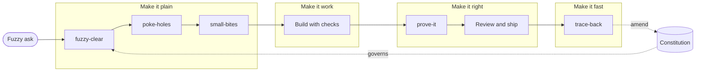

<div align="center">

# make-it-plain

### Make it plain. Make it work. Make it right. Make it fast.

**A working process for building software with AI agents.**
Written once, in open formats, for any agent: Claude, Codex, Cursor, Copilot, or whatever ships next.

by [Jonathan Kosar](https://github.com/jonathanmkosar)


</div>

---

## Where the name comes from

"Make it work, make it right, make it fast" is an old engineering line, usually credited to Kent Beck. It is good advice with a step missing from the front.

The missing step is much older. It comes from Habakkuk 2:2: write it down, plainly enough that whoever reads it can run with it. Today the reader is often an agent, and an agent will run with whatever it is handed, clear or not.

So this repo puts that step first.

## The point of view

Agents write code fast. Writing code was never the hard part.

The hard part is knowing what to build, and proving that what got built is right. Speed makes both worse: a vague ask now turns into a thousand lines of the wrong thing before lunch.

So I treat the agent as the builder and myself as the lead. I own the *what* and the *proof*. The agent does the typing.

I love the idea of a perfect system. I have also watched the pursuit of one kill the thing that was valuable. This one starts small, gets used, and gets amended. The record of those amendments is the part worth reading.

## See it work

**Fuzzy** (the ask that started this repo):

> "I want one way of starting work with agents that I can use anywhere and keep fixing."

**Plain** (after a round of questions with [`fuzzy-clear`](skills/fuzzy-clear/SKILL.md)):

| | |
|---|---|
| **Problem** | I have a process for agent-led work, but it lives in my head and in chat logs. Nobody can see it, and I can't improve what isn't written down. |
| **Who it's for** | An interviewer with 60 seconds first. A developer who wants to use it second. |
| **Done looks like** | The constitution, one working skill, and one real worked example are public. A stranger can run the skill in their own agent in under five minutes. |
| **Out of scope** | Anything tied to one vendor. Any employer material. Any claim I can't back with something in the repo. |
| **How we prove it** | Run `fuzzy-clear` cold in three different agents on the same fuzzy ask. All three produce a brief that passes the clear check. |

Full brief: [`docs/briefs/make-it-plain.md`](docs/briefs/make-it-plain.md)

## The loop



Every pass ends by asking what the process missed. The answer goes back into the rules, and the next pass is faster because of it.

## The constitution

Eight rules in four steps. Full text and reasoning in [`CONSTITUTION.md`](CONSTITUTION.md).

| Step | # | Rule | In plain words |
|---|---|---|---|
| **Make it plain** | 1 | Clarify before building | Problem, audience, and "done" are written down first. |
| | 2 | Context first | Read what exists before proposing anything. |
| | 3 | Plan before code | A reviewed plan is the cheapest place to be wrong. |
| | 4 | Small pieces | Every task can be built and checked on its own. |
| **Make it work** | 5 | Build with checks | Decide how to prove it before building it. |
| **Make it right** | 6 | Evidence, not claims | "It works" means test output, not a sentence. |
| | 7 | Normal pipeline | Agent code passes the same gates as anyone's. |
| **Make it fast** | 8 | Feed lessons back | Every miss becomes an amendment. |

## The proverbs

The constitution is how I work. The proverbs are how I build. They are short design sayings with no technology named, checked when a plan is reviewed, because a setting costs a sentence in a plan and a rewrite after. Each one also says when to break it. Full text in [`PROVERBS.md`](PROVERBS.md).

These six are mine. Swap in your own and nothing breaks: the plan review reads whatever proverbs a project has.

| # | Proverb | In plain words |
|---|---|---|
| 1 | Boil up what varies | Retries, timeouts, and limits are settings, not code. |
| 2 | Let the user decide at runtime | Where people differ, give them the choice while they use it. |
| 3 | Every launch has an off switch | Turn a feature off without a new release. |
| 4 | Add, don't edit | Extend by adding beside what shipped, not by reopening it. |
| 5 | Compose, don't inherit | Small pieces combined, not deep hierarchies. |
| 6 | Idle costs nothing | Pay for what is used, and nothing while nobody is using it. |

## The skills

| Skill | Rules | What it does | Status |
|---|---|---|---|
| [`fuzzy-clear`](skills/fuzzy-clear/SKILL.md) | 1, 2 | Interviews you in rounds until a vague ask becomes a one-page brief. | ✅ Ready |
| [`poke-holes`](skills/poke-holes/SKILL.md) | 3 | Attacks a plan before any code is written, and checks it against the proverbs. | 📝 Drafted, not yet run |
| `small-bites` | 4, 5 | Splits a plan into pieces that can each be checked. | 🔜 Planned |
| `prove-it` | 6 | Refuses "done" without evidence. | 🔜 Planned |
| `trace-back` | 8 | Finds which rule should have caught a failure and drafts the amendment. | 🔜 Planned |

Silly names, serious results.

## Amendments

The process is meant to be corrected by use. This log is the part I care about most.

| # | Date | What changed | Why |
|---|---|---|---|
| 003 | 2026-11-23 | Added six design proverbs and drafted `poke-holes`, the plan review that checks them. | The rules covered how to work, but nothing said how to build. |
| 002 | 2026-11-23 | Everything is written once in an open format. Tool-specific files are thin adapters only. | The first draft assumed one tool. A process that only works in one vendor's product is a habit, not a process. |
| 001 | 2026-11-23 | `kickoff` renamed `fuzzy-clear`. The readiness list became the "clear check". | The name should say what goes in and what comes out. |

Full history: [`AMENDMENTS.md`](AMENDMENTS.md)

## Use it

Each skill is a plain folder with a `SKILL.md` in the open [Agent Skills](https://agentskills.io) format. No build step, no dependencies.

**Any agent, zero setup.** Point it at the file:

```text
Read skills/fuzzy-clear/SKILL.md and follow it. Here's my ask: <your fuzzy ask>
```

**Installed as a skill.** Copy the folder into your tool's skills directory:

```bash
git clone https://github.com/jonathanmkosar/make-it-plain.git
cp -r make-it-plain/skills/fuzzy-clear <your-tool's-skills-folder>/
```

Then start with: *"fuzzy-clear this: ..."*

Tool-specific notes, where a tool needs one, live in [`adapters/`](adapters/README.md).

## How it's laid out

```text
make-it-plain/
├── CONSTITUTION.md      how I work: the eight rules, with reasoning
├── PROVERBS.md          how I build: the design sayings
├── AMENDMENTS.md        every change to either, dated, with why
├── AGENTS.md            how an agent should work in this repo
├── skills/              one folder per skill, written once
│   ├── fuzzy-clear/
│   │   └── SKILL.md
│   └── poke-holes/
│       └── SKILL.md
├── adapters/            thin, tool-specific wrappers, only where needed
└── docs/briefs/         real briefs produced by the process
```

**One rule for contributors, including me:** the content lives in `skills/` exactly once. If a tool needs something special, it gets a small file in `adapters/` that points back. Nothing is rewritten per vendor.

## About

I'm a senior developer working on AI platforms, and an Air Force veteran. I think a lot about how teams should work now that agents do most of the typing. This repo is where that thinking gets written down, tested, and corrected in public.

If you use a skill and it fails you, open an issue and tell me where it went wrong. That's how the next amendment gets written.

## License

[MIT](LICENSE). Use it at work, change it, ship it.
